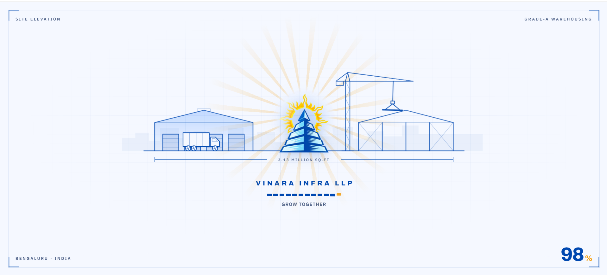
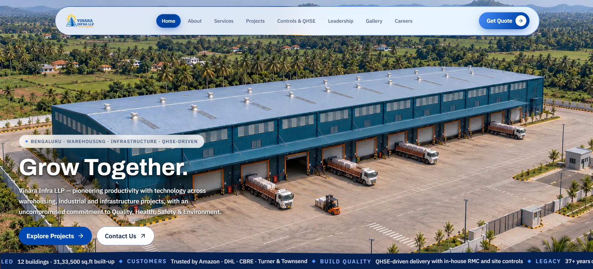
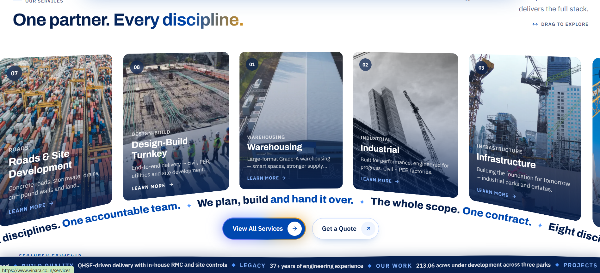
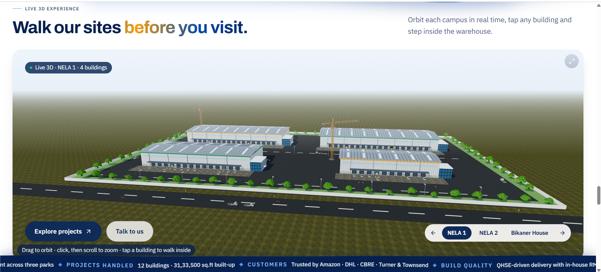
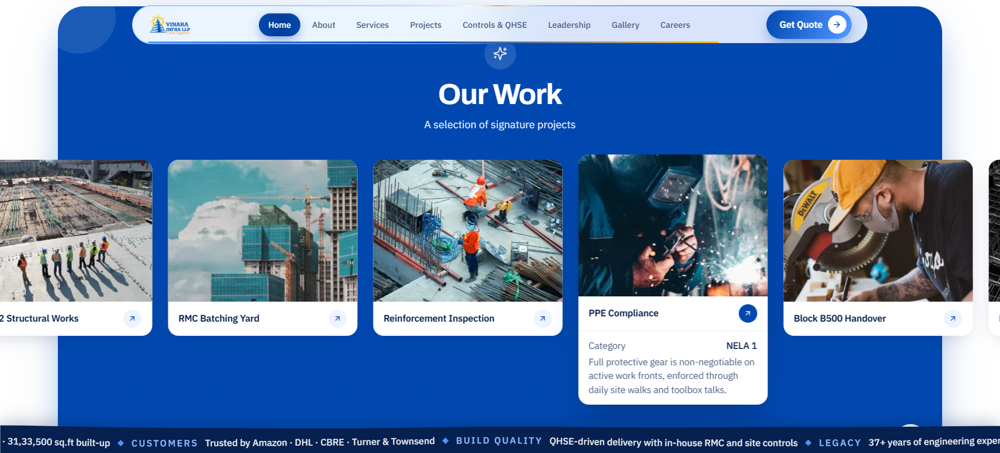

# How we built the Vinara Infra LLP website

This repo tells the story of how the Vinara Infra LLP website was built. It has the screenshots, the prompts we used, and the process. It does **not** contain the website's source code.

The site was built almost entirely by prompting an AI coding agent (Claude Code). We looked at the site in the browser, took screenshots, and wrote short plain-English instructions. The agent changed the code, and we checked the result and repeated.

- **[PROMPTS.md](PROMPTS.md)** has all 238 prompts in order, grouped by phase.
- **[screenshots/](screenshots/)** has the finished site.

---

## The finished site

**Logo preloader.** A line drawing of the site elevation shown while the page loads.

**Hero.** A full-screen drone view of the warehouse that scrubs frame by frame as you scroll, with a ticker of stats running along the bottom.

**Services.** Draggable cards in a curved arc, with a ribbon of text running underneath.

**Live 3D site plan.** A real-time 3D model of each warehouse park. You can rotate it, zoom in, and tap a building to walk inside.

**Our Work.** A gallery that scrolls on its own, with cards that open to show project details.

---

## How we made it

### The loop

1. **Look.** Open the site and find what feels wrong or plain.
2. **Screenshot.** Capture that exact section. 197 of the 238 prompts came with a screenshot attached.
3. **Prompt.** Write one short instruction, such as *"remove the empty white space"*, *"make this arc like in homepage"*, or *"in mobile it should be horizontal scroll"*.
4. **Review.** The agent edits the code and we reload the page.
5. **Repeat.** Push further (*"make it next level"*) or roll back (*"revert this"*).

Most prompts are a single sentence. The detail comes from the screenshot, not from long written specs.

### Timeline

| Phase | When | What happened |
|---|---|---|
| 1. First build | Sep 2026 | Next.js scaffold, first pages, team marquee pasted in from a component library |
| 2. Redesign sprint | 10 Oct 2026 | Over 100 prompts in one day: 3D warehouse scenes, arc card sections, scroll-driven hero, royal-blue theme, logo marquees, mobile horizontal scroll |
| 3. Motion & polish | 11 Oct 2026 | "Jelly" logo preloader, curved ribbons, text-reveal animations, mobile fixes, accurate map |
| 4. Going live | 15 Oct 2026 | Neon Postgres for admin data, Cloudinary for images, Resend for enquiry and job-application emails, Vercel deploy |
| 5. Client feedback | 27–29 Oct 2026 | Client change list worked through item by item, hero rebuilt from 4K video frames, realistic 3D models, admin security, single `info@` contact email |

### Stack

- **Framework:** Next.js 15 (App Router), React 19, TypeScript
- **Styling:** Tailwind CSS 4
- **Motion:** GSAP + ScrollTrigger, Motion, Lenis smooth scroll
- **3D:** three.js with React Three Fiber and Drei
- **Data and media:** Neon (serverless Postgres), Cloudinary
- **Email:** Resend
- **Hosting:** Vercel

### Techniques worth knowing

- **Scroll-scrubbed hero.** A 4K drone video was cut into still frames, and GSAP picks which frame to draw from the scroll position. This makes it feel like flying over the warehouse.
- **3D site plans.** The warehouse parks are modelled in three.js with trucks, roads and roller shutters. Visitors can orbit, zoom, and enter a building.
- **Admin panel.** The client can change projects, partner logos, leadership photos and gallery images without touching code.
- **Mobile-first rule.** On mobile, every card grid turns into a horizontal swipe row.

### Lessons

- A screenshot with one line of text works better than a long paragraph.
- Fix things one at a time. Small prompts are easy to check and easy to revert.
- Ask for a site-wide rule once (*"remove the white space between each section in the whole website"*) and the agent applies it everywhere.
- Never paste real keys into prompts. Put them in environment variables. All keys in [PROMPTS.md](PROMPTS.md) have been redacted.
